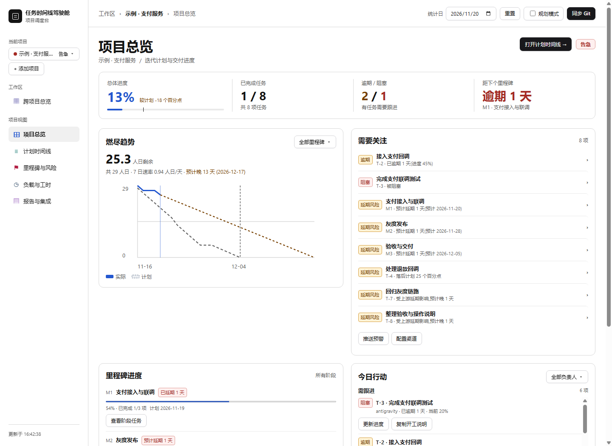

# 任务时间线驾驶舱

一个从 `plan/plan.md` 读取任务和里程碑的本地项目驾驶舱。团队可以在同一个界面查看交付进度、排期、风险和人员负载，也可以让 Codex 或 Antigravity 通过 MCP 认领任务、续租和更新进度。

## 快速开始

本机需要 Node.js 和 npm。项目使用 Node.js 内置模块和原生浏览器 ES 模块，无需先运行 `npm install`。Git 同步和历史回放需要 Git。

```sh
git clone --branch dev https://github.com/guiqingle520/task-orchestration.git
cd task-orchestration
npm start
```

已检出仓库时，直接在仓库根目录运行 `npm start`。打开 [http://localhost:5173](http://localhost:5173) 查看本仓库的项目计划。默认端口被占用时，可通过环境变量 `PORT` 修改端口。macOS 和 Linux 示例为 `PORT=5196 npm start`，Windows PowerShell 的写法见[操作手册](docs/USER_MANUAL.md#启动驾驶舱)。

要查看其他本地项目，点左栏「+ 添加项目」，选择目标仓库的根目录。驾驶舱会检查该目录下的 `plan/plan.md`。如果缺少计划，可预览模板并确认创建。



## 可以做什么

| 你要做什么 | 从哪里开始 |
| --- | --- |
| 看今天该处理什么 | 在「项目总览 → 今日行动」查看阻塞、逾期、即将到期和可开工任务。 |
| 看排期、依赖和关键路径 | 在「计划时间线」筛选任务、查看甘特图。规划者可在「规划模式」调整日期和依赖，也可用「模拟演练」先查看延期影响。 |
| 跟进多个项目与交付风险 | 在「跨项目总览」查看各项目进度，在「里程碑与风险」定位交付风险，在「负载与工时」查看人员负载和工时。 |
| 交接任务给同事或智能体 | 从任务详情认领或复制开工说明，在「负载与工时」查看在岗执行、超时租约、负责人名录和协同记录。 |
| 回看和分享项目进展 | 用「时间机器」回放 Git 历史，在「报告与集成」导出 Markdown、SVG 或可离线打开的 HTML。 |
| 同步外部协作信息 | 用 Git 提交同步任务进度，在「报告与集成」配置 GitHub / GitLab Issue 同步，或在风险页配置 Webhook 预警与周报渠道。 |

逐步操作和界面截图见[操作手册](docs/USER_MANUAL.md)。

## 计划与协作

每个项目用 `plan/plan.md` 文件开头的 YAML 记录项目、里程碑和任务。任务包含负责人、起止日期、依赖、状态和进度。初始化计划可参考[计划模板](plan/plan.template.md)，字段与修改权限见[计划规范](docs/PLAN_SPEC.md)。

- 规划者维护任务结构、日期和依赖。执行者更新自己任务的状态、进度和实际日期。
- 计划负责人（`owner`）表示任务归属，认领执行人（`actor`）表示当前由谁执行。认领后可续租、主动释放或在完工时自动释放。同一份计划的网页和 MCP 共用认领记录。
- 提交消息带上任务编号，例如 `T-3 60%` 或 `done T-3`。需要把提交进度同步到计划时，在驾驶舱点「同步 Git」或运行 `npm run plan:sync`。同步可能写入计划，并会跳过有活跃认领的任务。

### 接入 MCP

Codex CLI 可注册仓库中的 stdio MCP 服务。将示例路径换成实际的仓库绝对路径。

```sh
codex mcp add task-orchestration -- node "/绝对路径/task-orchestration/server/mcp.mjs"
codex mcp list
```

Antigravity 用户可在仓库根目录运行 `npm run plugin:install`，然后重新打开客户端。工具清单与认领到交付的示例见[操作手册的 MCP 一节](docs/USER_MANUAL.md#接入智能体-mcp-工具)。

## 开发与验证

| 命令 | 用途 |
| --- | --- |
| `npm start` | 启动本地驾驶舱。 |
| `npm run plan:check` | 校验计划字段、日期和任务依赖。 |
| `npm run plan:sync` | 扫描 Git 提交并同步进度，可能写入计划。 |
| `npm test` | 运行自动化测试。 |

`web/` 存放页面、样式与前端逻辑，`server/` 存放本地 HTTP 和 MCP 服务，`scripts/` 存放计划校验、Git 同步和插件安装脚本。开始编码前先按[仓库工作规则](AGENTS.md)更新排期。认领机制与多智能体协作的实现见 [M9 技术设计](docs/M9_DESIGN.md)。
