# 任务时间线驾驶舱操作手册

这份手册适用于负责查看进度、认领任务、调整排期或汇报项目的同事。更新于 **2026-11-22**，对应 `dev` 的 M9 任务认领与多智能体协作版本（`0493355`）。截图使用示例项目，实际名称、统计日和任务数据以你打开的项目为准。

| 你要做什么 | 从哪里开始 |
| --- | --- |
| 第一次启动、加载或添加项目 | [1. 启动与添加项目](#1-启动与添加项目) |
| 看今天该处理什么、更新进度 | [今日行动](#从项目总览开始今日行动) |
| 认领任务、把开工说明交给智能体、续租或接管 | [认领和交接任务](#认领和交接任务) |
| 查找任务、放大甘特图、查看任务详情 | [2. 查看和跟进任务](#2-查看和跟进任务) |
| 看交付进度、风险和人员负载 | [3. 跟踪里程碑与风险](#3-跟踪里程碑与风险) |
| 新建、拆分、拖动改期或演练延期 | [4. 调整排期与模拟延期](#4-调整排期与模拟延期) |
| 回看历史、对比快照、导出周报 | [5. 回看历史与分享进度](#5-回看历史与分享进度) |
| 看多个项目、配置日历或外部同步 | [6. 跨项目总览](#6-跨项目总览) · [7. 工作日历与工时](#7-工作日历与工时) · [8. Git 与外部协作](#8-git-与外部协作) |
| 看谁在执行、维护负责人和智能体名录 | [查看在岗动态和维护名录](#查看在岗动态和维护名录) |
| 在 Codex 或 Antigravity 中查询计划、写回进度 | [接入智能体 MCP 工具](#接入智能体-mcp-工具) |
| 排查故障或查找命令 | [9. 常见问题与命令](#9-常见问题与命令) |

## 1. 启动与添加项目

### 启动驾驶舱

1. 确认本机能运行 Node.js 和 npm。本项目没有额外的运行依赖，无需先执行 `npm install`。要使用 Git 同步或历史回放，还需要安装 Git。
2. 在项目根目录打开终端，运行以下命令。

   ```sh
   npm start
   ```

3. 在浏览器打开 [http://localhost:5173](http://localhost:5173)。以终端实际显示的地址为准，不要直接双击打开 `web/index.html`。
4. 打开后先核对左侧「当前项目」和顶部「统计日」，再看项目总览。调整统计日可以用当前计划数据重新计算某天的进度、逾期和预测，**不会切换到那天的历史版本**；要回看历史，用「时间机器」。看完模拟日期可点「重置」，再继续记录实际进度。

如果默认端口被占用，macOS 或 Linux 可运行 `PORT=5196 npm start`。Windows PowerShell 可用下面的命令改用 5196。

```powershell
$env:PORT = '5196'
npm.cmd start
```

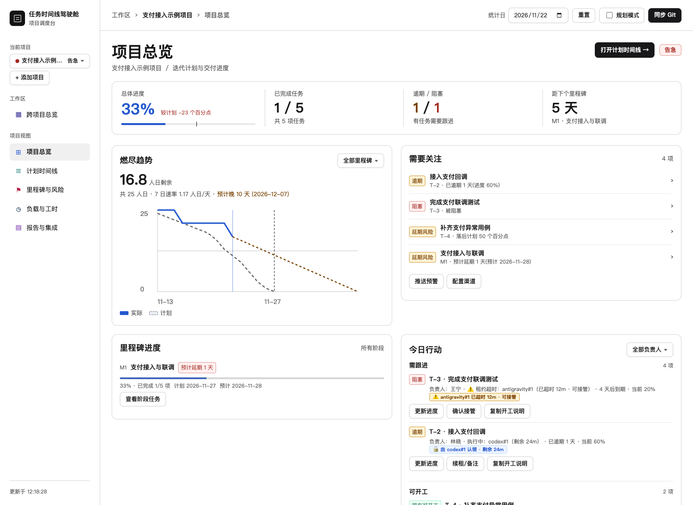

「项目总览」里的总体进度按任务计划工期加权，进度条上的刻度表示统计日应达到的计划进度。旁边的卡片显示已完成任务数、逾期与阻塞任务数，以及下个待交付里程碑。单项目与跨项目采用同一规则，显示仍有未完成任务且计划交付最早的阶段。这个阶段即使已经逾期也会显示。所有阶段都已完成或没有任务时，显示「无待交付里程碑」。

左侧「跨项目总览」用于看整个工作区。「项目总览」「计划时间线」「里程碑与风险」「负载与工时」「报告与集成」显示当前项目的信息。

### 添加和切换本地项目

1. 点左栏「+ 添加项目」。如需自定义项目代号或显示名称，可在选择目录前填写。然后点「选择文件夹」选中仓库根目录，也可以手动输入绝对路径（例如 `D:/dev/payment-service`），再点「检查并注册」。
2. 如果目录中有有效的 `plan/plan.md`，驾驶舱会直接注册并切换。如果缺少计划，窗口会显示将要创建的文件内容。核对模板后点「确认创建并注册」，或点「取消」退出。注册表保存在本机的 `plan/workspaces.json`。
3. 如果现有计划无法解析或校验失败，窗口会显示具体错误并保留原文件。修正计划后点「检查并注册」重试。[计划格式规范](PLAN_SPEC.md)
4. 平时切换直接打开「当前项目」下拉框，按名称片段或编号搜索。绿色是「正常」，琥珀色是「有风险」，红色是「告急」，灰色是「不可用」。用方向键移动、回车选择、`Esc` 关闭；搜索本身不会更改当前选项。

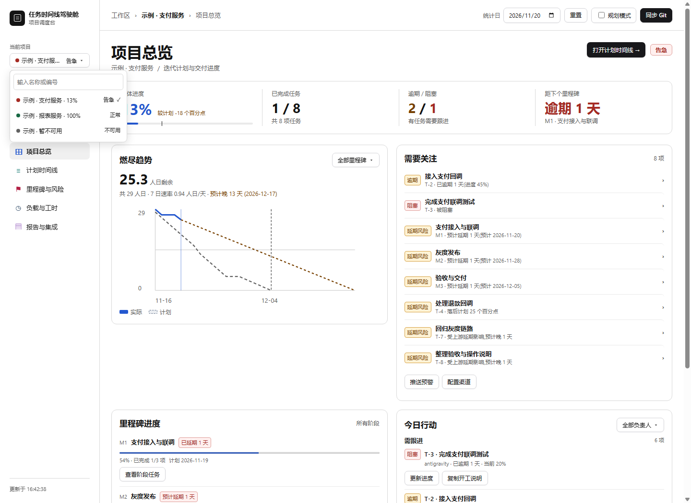

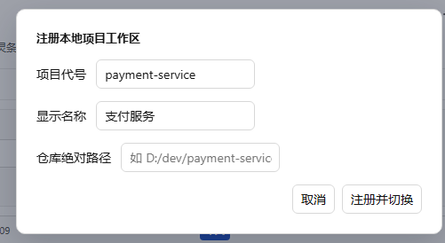

## 2. 查看和跟进任务

### 从项目总览开始今日行动

1. 打开「项目总览」，找到「今日行动」。「负责人」按计划归属筛选，同时应用于「需跟进」和「可开工」。要按实际执行人看手头任务，打开「负载与工时」的在岗列表。
2. 「需跟进」依次列出阻塞、逾期和七天内到期的未完成任务。「可开工」只列出尚未开始、且全部前置已完成的任务，无前置依赖也可入选。计划开工日已到时显示「现在可开工」，计划开工日尚未到时显示「可提前开始」。
3. 点任务标题可在时间线定位。点「更新进度」可直接保存状态和进度，保存后会重新计算下游任务是否可开工。如果弹窗提示计划已变化，关闭后重新打开任务，核对最新状态再保存。
4. 看任务旁的「待认领」、持锁剩余时间或「已超时」标记，再决定直接认领、联系执行人或确认接管。已有认领的任务仍可能出现在「可开工」，因为开工条件按任务状态与前置依赖计算。


### 认领和交接任务

1. 先核对**计划负责人**和**执行人**。任务里的负责人（`owner`）表示计划归属，当前认领的执行人（`actor`）负责这一轮执行。例如计划负责人是林晓，实际执行人可以是 `codex#1`。同时运行多个智能体会话时，为每个实例使用独立的执行人标识。
2. 自己开工时，在「今日行动」或时间线下方的任务详情点「认领任务」，填写执行人标识、类型和租约时长，再点「确认」。默认时长为 AI 智能体 **30 分钟**、人类负责人 **480 分钟**，可按名录设置或本次输入调整。服务端接受的范围分别是 **5–240 分钟**和 **5–1440 分钟**。
3. 交给协作者时点「复制开工说明」。说明包含任务、计划日期、进度、前置任务、验收要求和当前认领信息。验收要求取自计划正文的「任务 | 验收要求」或「任务 | 验收标准」表格，任务编号单独填在第一列。选「仅复制说明（不改状态）」可以只分享上下文，任务与认领保持原样。选「认领并复制说明」时，先填**接下来实际执行的标识**，再把生成的说明粘贴给对应的协作者或智能体。若提示认领成功但剪贴板访问失败，从预览框手动复制即可。
4. 默认认领只占用任务，进度保留原值。要同时开工，勾选「认领时同步将未开始任务设为『进行中 (10%)』」。如果提示「已认领，未更新为进行中」，刷新任务后用当前认领更新进度。成功认领后，可在任务详情核对执行人、到期时间和租约代次。

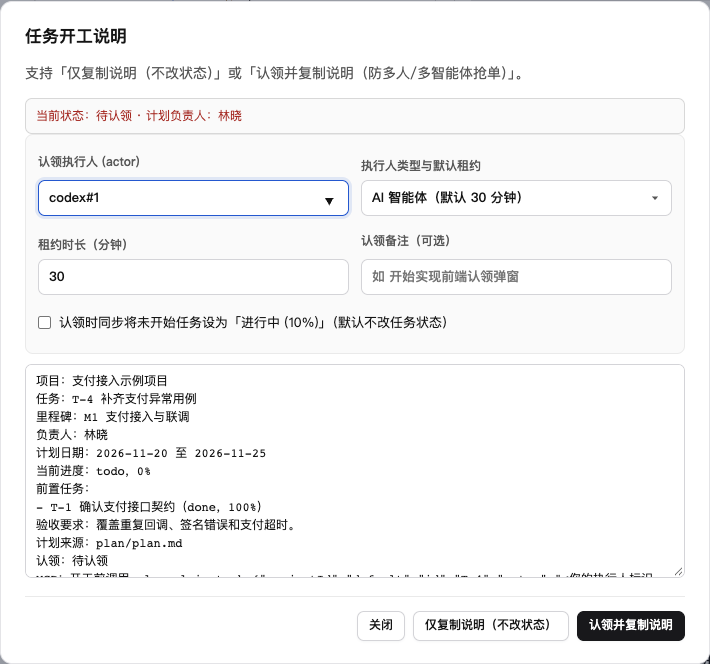

| 执行到哪一步 | 怎么操作 |
| --- | --- |
| 还要继续做 | 在任务详情点「发送心跳/备注」，或在「今日行动」「负载与工时」点「续租/备注」。核对执行人，填写时长和进展，确认后从本次心跳重新计算到期时间。 |
| 暂停或主动交回 | 在任务详情点「释放认领锁」，或在在岗列表点「释放」。如需记录进度，先保存再释放。释放后其他人可认领。 |
| 已做完 | 将状态保存为「已完成」，进度为 100%。驾驶舱会释放该任务的认领。 |
| 租约已超时 | 先与原执行人核对进展。原执行人可在接管前续租；换人时点「确认接管」，填写新执行人，勾选确认后提交。接管会生成新租约代次，旧代次提交的操作会被拒绝。 |
| 活跃租约需要人工干预 | 在任务详情或在岗列表使用「强制接管」或「强制解锁」，填写至少两个字的原因。接管将执行权交给指定标识，解锁后任务可重新认领。操作会记入审计。 |

### 搜索、缩放和全屏

1. 点侧栏「计划时间线」。如果工具栏已收起，点「展开筛选与工具」。在「搜索任务」输入任务编号或标题片段，例如 `支付`，也可组合状态、负责人和里程碑筛选。看不到任务时先核对匹配数量和里程碑是否折叠，再点「清空筛选」。
2. 用「适应 / 日 / 周 / 月」调整时间轴颗粒度。「回到今天」以当前统计日为准。上下滚动甘特图时，「任务与状态」和日期表头固定在图表顶部。左右滚动时，任务列固定在左侧，日期刻度与任务条一起移动。点里程碑分组行可折叠或展开该阶段，也可以操作「全部展开 / 全部折叠」。
3. 需要更大的画面，点右上角「展开时间线」。侧栏和分析区收起，甘特图铺到浏览器内容区。继续打开按钮旁的箭头，选「浏览器全屏」可尝试隐藏浏览器边框；如果环境不允许，仍可使用展开视图。
4. 在专注或浏览器全屏视图中，点「收起筛选与工具」，图表会填满释放的高度。再点「展开筛选与工具」会回到工具栏。窄屏或较矮的窗口进入专注模式时，工具栏默认收起。需要看选中项时，点「任务详情 ↓」。按 `Esc` 或点「退出专注 / 退出全屏」，可回到原页面和图表滚动位置，继续使用之前的筛选、缩放和选中项。

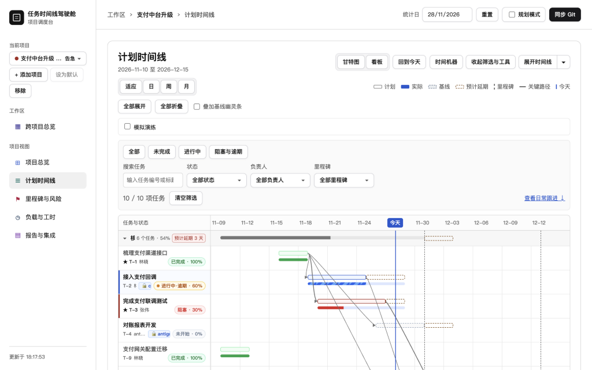

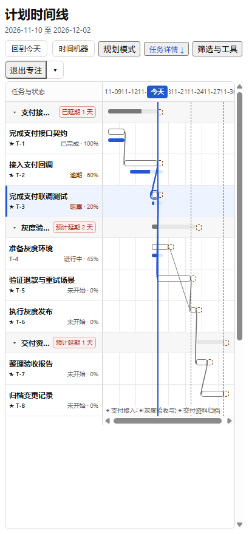

| 图里的标记 | 怎么读 |
| --- | --- |
| 白底边框条／彩色实际条 | 白底边框条是计划区间；实际条表示执行区间，深色部分体现完成进度。 |
| 灰色虚线条／预计延期虚线框 | 叠加基线后，灰色虚线条是历史排期；任务计划条末端的延期框表示预计延长的部分。 |
| 里程碑虚线／「今天」蓝线 | 分别定位计划交付日和当前统计日。任务前的 ★ 标记关键路径；连线显示依赖。 |
| 任务名称旁的锁／「超时」徽标 | 锁表示当前有活跃认领，「超时」表示该租约已过期。点任务行可查看执行人、到期时间和认领操作。 |

筛选只改变甘特图和日常跟进列表的可见范围，依赖线只在两端任务可见时画出。项目总览、里程碑总体进度、燃尽图和导出仍按各自的完整范围统计。

### 从跟进列表定位并更新进度

1. 在筛选栏点「查看日常跟进 ↓」。列表按**阻塞、逾期、七天内到期**的顺序显示；已完成任务不列入，同一任务只出现一次。只想看自己的待跟进事项，可先在「负责人」选择自己的名字。
2. 点一项，例如图中的 `T-3 完成支付联调测试`。驾驶舱会展开所在里程碑，在甘特图中定位并高亮任务。
3. 确认顶部未开启「规划模式」，在图下点「编辑任务」。选择「未开始 / 进行中 / 阻塞 / 已完成」，再填 0–100 的进度。「未开始」会归零并清除实际日期，「已完成」会锁定 100% 并补记实际日期。任务有活跃认领时，核对「执行人标识」与当前持有人一致。代领的任务仍按计划负责人统计。
4. 点「保存」，核对任务行中的状态和进度是否更新。保存写回当前项目的 `plan/plan.md`；遇到计划已变化提示时，关闭弹窗并重新打开任务，核对最新值后再改。
5. 要发给协作者定位，点任务详情中的「复制任务链接」。链接指向特定项目和任务，只在能访问同一个本地驾驶舱的环境中有效。要给无法访问驾驶舱的人查看，使用[导出离线网页](#5-回看历史与分享进度)。

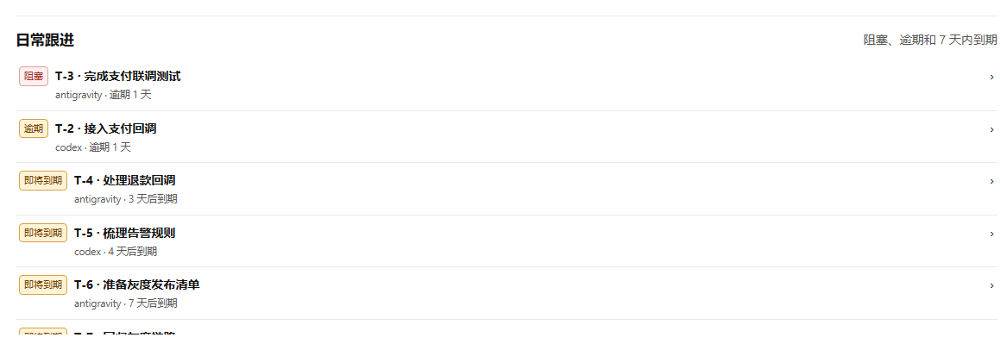

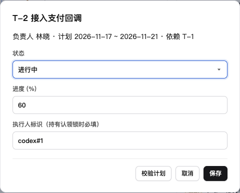

## 3. 跟踪里程碑与风险

1. 点侧栏「里程碑与风险」，查看全部交付阶段。每个阶段显示进度、已完成／总任务数和计划交付日。空阶段显示「暂无任务」。点「查看阶段任务」，会跳到甘特图并查看该阶段。
2. 读取红色延期标签：「已延期」表示统计日已超过计划交付日且仍有任务未完成；「预计延期」表示预计完工日期晚于计划；「延期完成」表示阶段已完成，但实际完成日晚于原计划。**交付日当天不算已经延期**。
3. 在该页的风险卡片查看具体原因。列表可能出现阻塞、逾期、落后计划和依赖传导，点风险项可在甘特图定位对应任务或阶段。
4. 「项目总览」的「燃尽趋势」可按里程碑切换统计范围，查看剩余人日、七日完成速率和预计完工。「速率待形成」表示现有数据不足以给出完成日期。查看每周并行峰值时，从侧栏进入「负载与工时」。

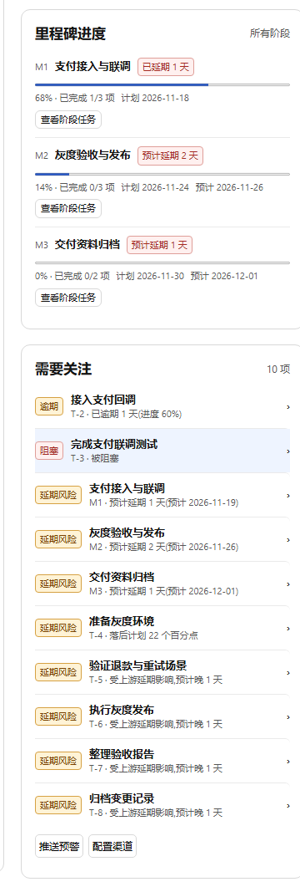

## 4. 调整排期与模拟延期

### 保存实际排期

结构、计划日期和依赖由规划者维护。需要正式调整时，先在顶栏开启「规划模式」；专注模式顶部也有同名按钮。

| 要改什么 | 操作与保存前检查 |
| --- | --- |
| 新建任务或里程碑 | 点「+ 新建任务」或「+ 新建里程碑」。任务填写标题、负责人、所属阶段和起止日。负责人可从名录选择，也可直接输入新的标识。前置依赖填任务 ID（例如 `T-2, T-4`），没有就留空。填写变更原因，检查后保存。 |
| 改期 | 拖动任务的计划条中间可整体平移，拖左右手柄可调整起止。松手后会弹出日期变更预览，例如「调整 T-4 的计划日期」。核对起止日和冲突；确认要移动下游时再选「同时顺延受影响的任务」，填原因后点「保存变更」。 |
| 新增或解除依赖 | 从前置任务右侧锚点拖到下游任务行。解除时点现有依赖线。两种操作都要看预览再确认；循环依赖和新引入的排期冲突不能直接保存。 |
| 拆分任务 | 选中任务，打开「规划/拆分任务」，核对当前字段后点「拆分为两个子任务」。原任务作为上段，系统生成「下」段并把原下游任务改为依赖下段。此按钮会执行写入，先填写变更原因并核对预期。 |

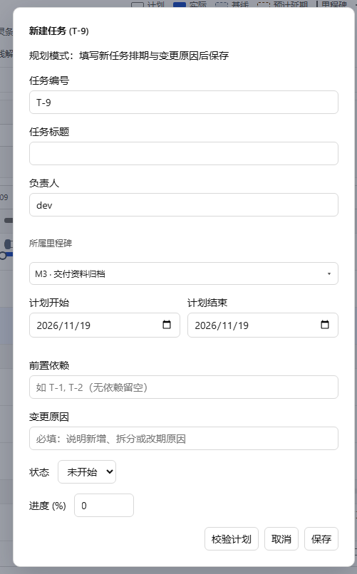

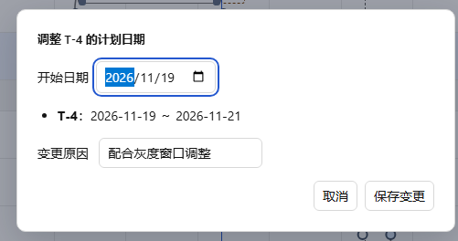

如果受改动的任务有活跃认领，先协调执行人释放租约再保存。需要立即调整时，在预览或编辑弹窗勾选「强制覆盖」活跃认领锁，核对受影响任务并填写变更原因。保存会解除受影响任务的认领并留下审计记录。

完成后检查甘特图的新日期和依赖，必要时核对 `plan/plan.md` 的「计划说明」。多人同时改动时，以最新计划为准，重新打开弹窗再确认。

### 只演练某项任务延后

1. 勾选「模拟演练」。在任务选择器中搜索 `T-2`，填「延期天数」为 `2`，点「推演」。也可拖动图上的蓝色**模拟条**。
2. 查看控制栏下方列出的受影响任务、里程碑和关键任务。模拟按前置结束后的次日开工推演；正式规划允许前置结束当天交接，两者日期可能不同。
3. 点「清空推演」移除所有模拟延期量；取消勾选则关闭演练。演练结果不写入计划，不会改动正式排期。

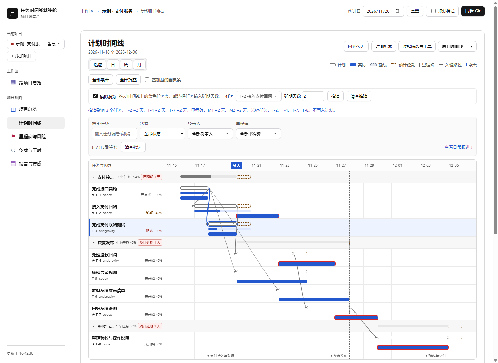

## 5. 回看历史与分享进度

### Git 历史回放与浏览器快照

1. 当前项目需有提交过 `plan/plan.md` 的 Git 历史。在时间线顶部点「时间机器」，拖动滑块选择提交，或点「▶ 播放」按 **1x / 2x** 连续回放。控制栏显示当前快照的提交日期、说明和当时进度。拖动滑块会暂停自动播放。
2. 回放是只读的。任务编辑、规划模式、同步 Git 和认领操作不可用，实时认领状态会隐藏。想对比起初排期，在工具栏勾选「叠加基线幽灵条」，留意虚线条和 `+2天` 等差值。点「退出回放」返回当前计划。
3. 要比较手工留存的计划，先退出回放，再进入「报告与集成」，在「基线与历史快照」里点「保存当前快照」。改动计划后在下拉框选旧快照，点「对比」查看新增、移除或字段变更。手工快照按项目保存在当前浏览器中。

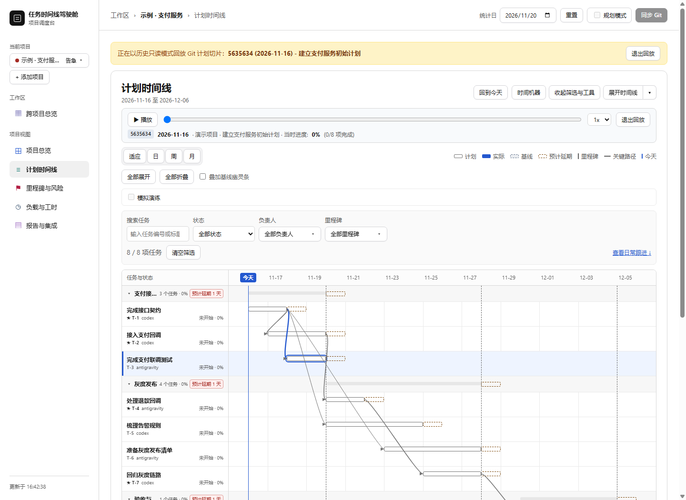

### 单项目报告与离线网页

先检查当前项目和统计日，再进入「报告与集成」，找到「进度报告」。

| 按钮 | 产出与用途 |
| --- | --- |
| 导出 Markdown | 下载含近七天动向、里程碑、风险和任务明细的文字报告；适合放入周报。 |
| 导出 SVG | 下载任务进度矢量图；适合插入文档或幻灯片。 |
| 复制摘要 | 复制当前项目总体进度、完成量、阻塞和逾期一句话摘要。 |
| 导出离线网页 | 生成一个可在浏览器断网打开的 HTML；适合交付给没有本地驾驶舱的人。 |
| 推送周报 | 向已启用且允许当前项目的 Webhook 渠道发送周报；先确认渠道。 |

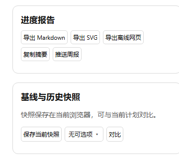

导出离线网页时，输入对方容易辨认的标题。对外分享建议勾选「匿名化负责人」和「排除 Git 提交和标记的内部备注」。**任一脱敏项都会排除 Git 提交**；项目、任务和里程碑标题中的普通文字仍可能保留。点「生成并下载 HTML」，再从下载目录打开文件，检查预期范围和脱敏结果，然后发送文件。

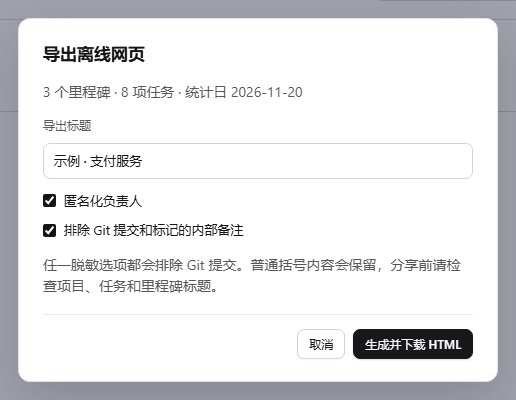

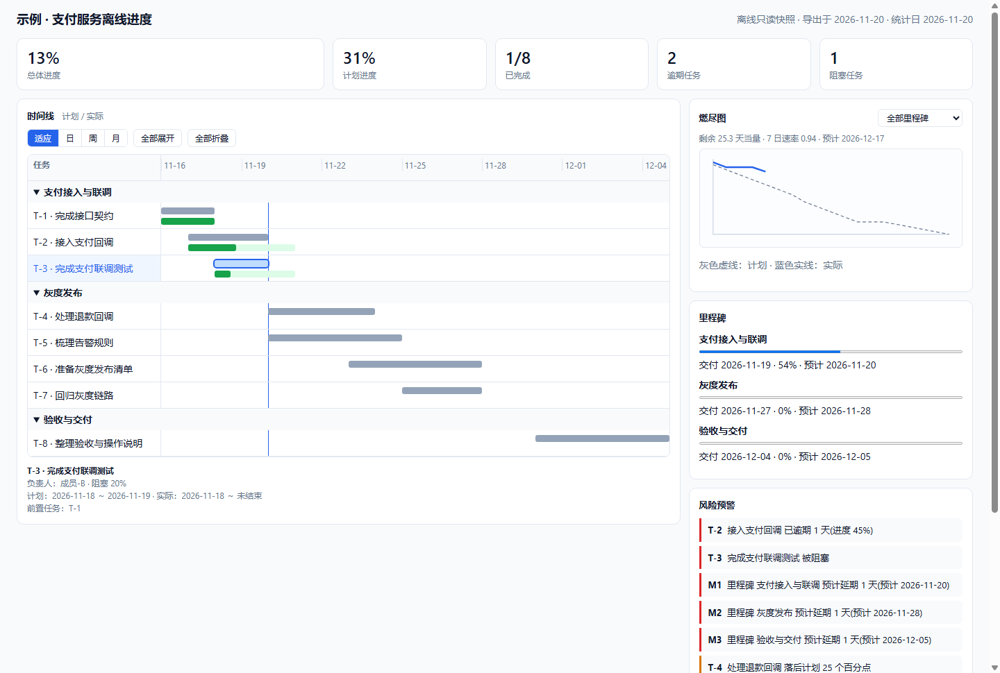

## 6. 跨项目总览

1. 点左侧「跨项目总览」，所有已注册项目按顶部同一个统计日计算。先看已注册／可用项目数，再看可用项目的阻塞、逾期合计；同一任务可能同时阻塞和逾期，两个统计项分别计数。
2. 有阻塞或逾期的项目优先显示。下一个里程碑是**仍有未完成任务且计划交付最早**的阶段，已经过期的待交付阶段仍会列出。不可用项目单列，不计入风险合计。
3. 点「打开项目」进单项目驾驶舱，或点「查看里程碑」直达阶段进度。跳转使用总览所显示的统计日。
4. 点「复制 Markdown 摘要」可分享当前这份快照的统计日、项目名称、进度、风险计数和里程碑。摘要会列出不可用项目，不含任务明细、负责人、Git 记录或本地路径。如果浏览器禁止访问剪贴板，页面会显示可手动复制的摘要。

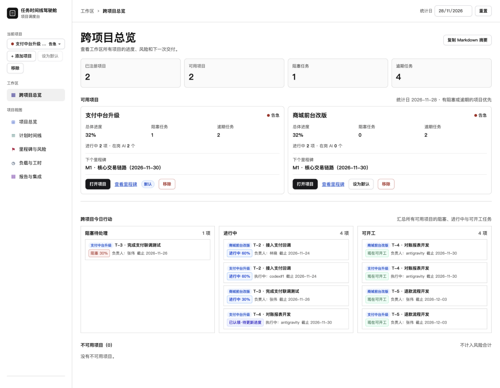

## 7. 工作日历与工时

1. 从侧栏进入「负载与工时」，在「工时与预估核算」点「配置日历 / 工时」。设置每日标准工时，决定是否自动排除周末。
2. 在「节假日」和「调休补班日」中按 `YYYY-MM-DD` 每行填写一个日期。同一天重复出现时，节假日优先。例如图中 `2026-11-21` 是补班日，`2026-11-27` 是节假日。
3. 按任务填写故事点、预估工时和实际工时。**填写 `0` 与留空不同**：`0` 会作为实际数值保留；留空才使用默认值或推算。
4. 点「保存配置」，回到卡片核对已填报与推算工时、预估准确率和实测样本数。实测准确率基于可比较的已完成任务，不要把推算工时当作已填报工时。

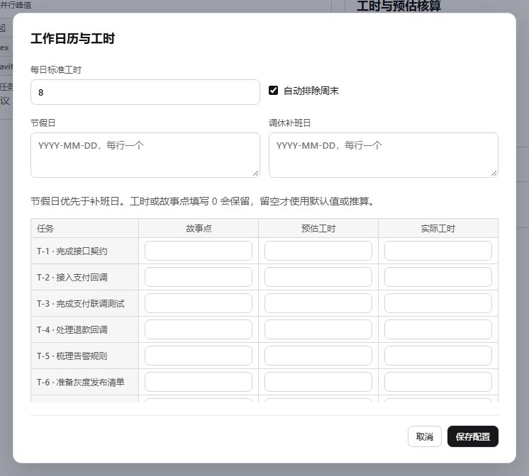

### 查看在岗动态和维护名录

1. 在「负载与工时」打开「在岗执行动态与负责人名录」。先看活跃认领、超时可接管和孤儿租约的数量，再看任务卡片上的执行人、剩余时间和最新进展。点任务标题可回到甘特图。租约按服务器当前时间计时，页面显示近似值，点「刷新动态」可重新读取。
2. 「多负责人与智能体协同概览」按计划负责人统计「未完计划归属」和「待认领可开工」，按实际执行人统计「当前持锁执行」。需要追查交接时，展开「近期协同事件与审计流」，在「常规协同」看认领、释放与完工，在「接管与强制解锁审计」看接管、强制操作与原因。
3. 点「管理负责人名录」，可修改显示名称、分类和默认租约时长。点「+ 新增负责人 / 智能体」时填写唯一标识，例如 `codex#1`，再点「保存名录」。名录也会根据同一项目计划中的负责人及现有认领的执行人补充选项。要变更任务的计划归属，进入规划模式编辑任务的「负责人」字段。
4. 发现「孤儿租约」时，先核对相应任务确实已移除，再点「一键清理孤儿租约」，也可以在保存名录时勾选清理。默认情况下，认领、名录和事件保存在当前项目的 `plan/claims.json`，由指向同一项目计划文件的网页与 MCP 共用。Git 忽略该文件，离线网页导出也会排除这些数据。

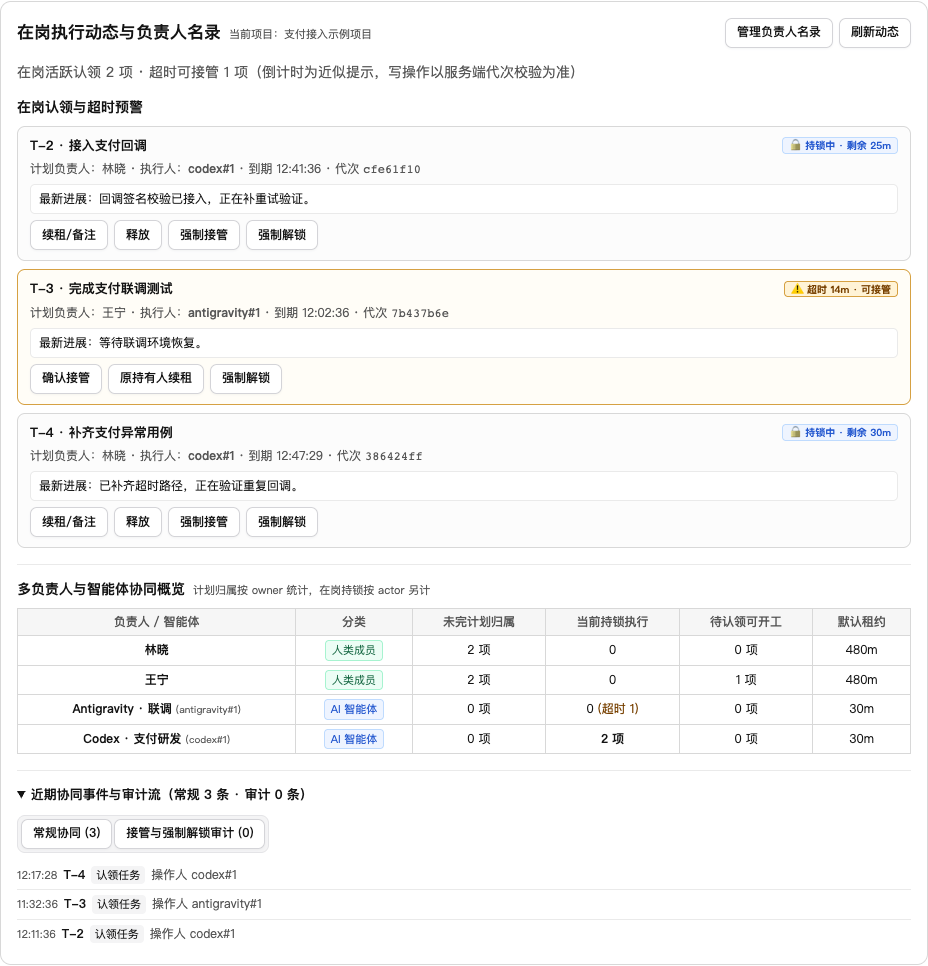

## 8. Git 与外部协作

### 用 Git 提交推进任务

手动方式：切到正确的项目，点顶栏「同步 Git」；也可以在仓库根目录运行 `npm run plan:sync`。都会扫描带任务编号的提交并**可能写回计划**。同步会跳过被活跃租约锁定的任务。同步后查看结果，并用 `git diff -- plan/plan.md` 核对改动。持有人可直接更新进度，或先释放认领再重新同步。

如果团队希望提交时自动更新，先确认仓库的 Git 钩子配置，再按团队约定运行 `git config core.hooksPath .githooks`。启用后提交前会校验计划，提交消息也可以触发相应更新。

| 提交消息示例 | 对任务的影响 |
| --- | --- |
| `feat(T-2): 接入支付回调` | 如果任务原来未开始，则进入进行中并记为 10%。 |
| `T-2 60%` | 记为进行中、60%。 |
| `done T-2` 或 `T-2 100%` | 记为已完成、100%，补齐实际日期。 |
| `blocked T-2` 或 `T-2 阻塞` | 记为阻塞。 |

### 配置 Webhook 预警和周报

1. 打开「里程碑与风险 → 配置渠道 → + 添加渠道」。选择飞书、钉钉、企业微信或通用 JSON，输入渠道名称和公网 `https://` Webhook 地址。
2. 勾选「允许发送的项目」里的目标项目，再勾选「启用渠道」。只有允许接收当前项目且已启用的渠道会收到消息。需要自动预警时，另外勾选「新增红色高危风险时自动推送」。
3. 点「保存配置」。然后在风险区点「推送预警」，或在进度报告点「推送周报」。结果会显示成功和失败数量。旧渠道若没选允许项目，先重新打开配置勾选再试。
4. Webhook 地址是凭据，本机配置保存在 `plan/webhooks.json`，不应贴进周报、截图或源码。重新打开已配置的渠道，URL 字段留空可保留原地址。

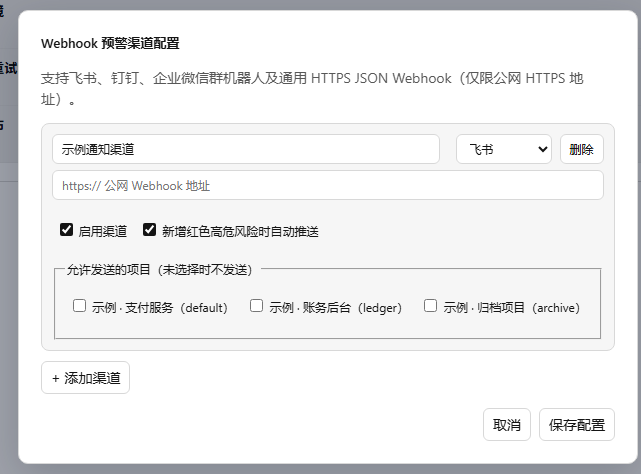

### 同步 GitHub / GitLab Issue

1. 进入「报告与集成」，在「平台集成」点「配置平台」。选择平台，填写正确的仓库（GitHub 如 `owner/repo`，GitLab 可使用项目 ID），核对 API 地址和具备相应 Issue 权限的 Token。勾选「启用此项目的集成」，点「保存平台配置」。修改仓库或 API 地址会清除旧绑定，启用新目标要重新输入 Token。
2. 从远端拉取时，点「Issue 同步」，选任务范围，再点「预览远端拉取」。没选任务时，预览会检查全部任务。先看状态、进度和日期变更，以及被跳过的冲突。活跃认领会阻止对应任务的进度拉取。核对后点「确认写入」。如果预览失效，重新预览并检查认领、计划、绑定和远端状态。
3. **向远端推送**：确认目标仓库，选择任务，再点「推送到平台」。不选择任务时，须勾选「允许全量推送」并确认。推送会创建或更新 Issue，可能发送任务标题、负责人、排期和依赖；在推送前核对仓库和内容是否适合共享。
4. 同步后检查结果中的新建、更新和失败数量。已绑定的任务详情会显示 Issue 链接。若远端没有应用标签，先检查 Token 权限与仓库中是否有 `task-orchestration`、`milestone:…` 和 `status:…` 标签。

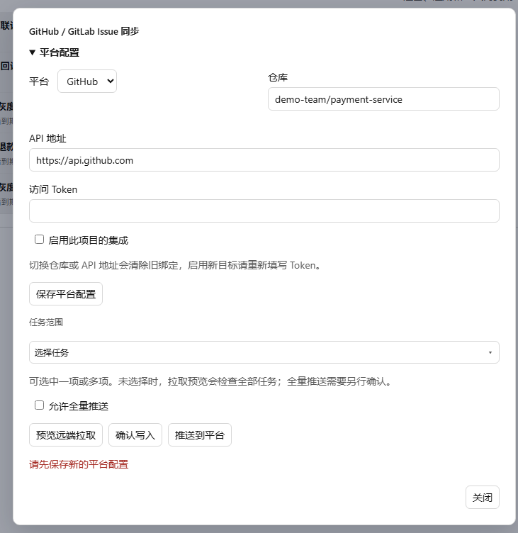

### 接入智能体 MCP 工具

**Antigravity** 在仓库根目录运行 `npm run plugin:install`。脚本会将插件复制到用户的 `.gemini/config/plugins/task-orchestration`，并写入指向当前仓库的 MCP 配置。重新打开客户端后，在工具列表中确认 `task-orchestration` 可用。

**Codex CLI** 注册同一个 MCP 服务。把示例命令中的路径换成实际仓库的绝对路径，保留引号。

```powershell
codex mcp add task-orchestration -- node "D:/dev/task-orchestration/server/mcp.mjs"
codex mcp list
```

开启新会话后，可先让智能体「列出驾驶舱中的项目」，再用返回的项目 ID 指定任务，例如「查看项目 `default` 的 T-59 和验收要求」。MCP 会由客户端启动，本地网页服务可独立启停。移动仓库后，需要更新指向旧目录的 MCP 配置。

| 工具 | 可以做什么 |
| --- | --- |
| `plan_list_projects` | 列出已注册项目及其状态、进度、阻塞与逾期数。 |
| `plan_get_overview` | 查看总览、需跟进和可开工事项。传入 `unclaimedOnly: true` 可排除活跃认领，超时任务仍需确认接管。 |
| `plan_get_task` | 读取任务、验收要求、开工说明、认领信息 `claim` 及执行字段快照 `expected`。 |
| `plan_validate` | 校验指定项目的计划。 |
| `plan_claim_task` | 用 `id`、`actor` 认领并取得 `claim.leaseId`。可传 `actorKind`、`ttlMinutes`、`note` 或 `startImmediately`。 |
| `plan_heartbeat_task` | 用 `id`、`actor`、`leaseId` 续租，可附上 `ttlMinutes` 和 `note`。 |
| `plan_update_task` | 用 `id`、`expected`、`status`、`progress` 写回进度，可填写实际日期。持锁执行时同时传 `actor` 和 `leaseId`。 |
| `plan_release_task` | 用 `id`、`actor`、`leaseId` 正常释放认领。 |

#### 用 MCP 完成一次认领和交付

1. 用 `plan_list_projects` 核对项目 ID，并在后续调用中使用同一个 `projectId`。接着用 `plan_get_task` 核对任务编号、前置状态和验收要求。
2. 任务待认领时，调用 `plan_claim_task`。例如传入 `{"projectId":"default","id":"T-4","actor":"codex#1","actorKind":"agent","startImmediately":true}`。保留返回的完整 `claim.leaseId`。如果从网页收到已经认领的开工说明，先核对说明里的执行人和租约代次与当前任务一致，再沿用该租约。
3. 到期前发送心跳。写回前重新调用 `plan_get_task`，把最新返回的 `expected` 原样传入 `plan_update_task`，并带上自己持有的 `actor` 和 `leaseId`。确认完成后提交 `status: "done"`、`progress: 100`，任务会自动释放。提前交回时调用 `plan_release_task`。
4. 若确需接管超时任务，协调原执行人后，调用 `plan_claim_task` 并传入 `takeoverStale: true`、刚读到的租约代次（`expectedLeaseId`）与新执行人的标识。后续调用使用返回的新代次。遇到 `LEASE_SUPERSEDED` 时停止使用旧租约。遇到普通的 `CONFLICT` 时重新读取任务，核对字段后再提交。

计划结构、依赖和计划日期由规划者在规划模式中维护。

## 9. 常见问题与命令

| 遇到的问题 | 先检查什么 |
| --- | --- |
| 浏览器打不开驾驶舱 | 看终端是否仍在运行、端口是否与地址一致。默认是 5173，自定义端口要改浏览器地址。 |
| 切换后显示「项目计划不可用」 | 确认注册路径没被移动，仓库根目录下仍有 `plan/plan.md`。在对应项目目录运行校验，再刷新。 |
| 甘特图找不到某项任务 | 检查当前项目、筛选和折叠状态。若在时间机器内，该版本还可能没有这项任务。 |
| 时间线找不到搜索或缩放控件 | 点顶部「展开筛选与工具」。在专注或全屏中，页面会定位到工具栏。 |
| 编辑按钮消失或变灰 | 检查是否处于历史回放、跨项目总览或项目不可用。回到单项目实时视图再试。 |
| 提示计划已变化或操作不能保存 | 重新打开任务获取最新状态；规划改期时检查日期、依赖冲突和是否填写变更原因。 |
| 网页显示「认领状态未知」，或 MCP 工具列表缺少认领工具 | 确认网页和 MCP 都指向新版仓库。重启网页服务与 MCP 客户端，切回正确项目，再点「刷新动态」。 |
| 提示「任务已被认领」或 `TASK_LOCKED_BY_CLAIM` | 先看当前执行人和到期时间。由持有人继续更新，或协调释放后再认领。 |
| 提示租约已失效或被接管（`LEASE_SUPERSEDED`） | 刷新任务并核对当前持有人和租约代次。若持有人已更换，先把本地进展交接给对方。 |
| 办公电脑与另一份代码副本的认领状态不同 | 核对两端是否指向同一个项目计划文件。认领数据保存在对应目录下，Git 拉取只会带来已提交的计划变更。 |
| 离线导出显示找不到接口，或更新后新增接口不可用 | 停止原来的 Node 服务，在新版项目目录重新运行 `npm start`，再刷新页面。浏览器刷新不会更新仍在运行的服务。 |
| 「浏览器全屏」无法开启 | 使用「展开时间线」即可铺满内容区；有些内嵌浏览器会禁止网页进入全屏。 |
| 推送渠道不可用／Issue 预览无法确认 | 核对当前项目、允许接收的渠道或平台配置。Issue 若提示预览失效，从「预览远端拉取」重新开始。 |

| 命令 | 用途 |
| --- | --- |
| `npm start` | 启动驾驶舱。 |
| `npm run plan:check` | 校验当前项目计划的字段、日期和依赖。 |
| `npm run plan:sync` | 扫描 Git 历史并按需要同步进度，可能写计划。 |
| `npm run mcp` | 启动标准输入输出 MCP 服务，供客户端调用。 |
| `npm run plugin:install` | 将 Antigravity 插件安装到用户目录并打印 Codex CLI 接入命令。 |
| `npm test` | 运行项目自动化测试。 |
